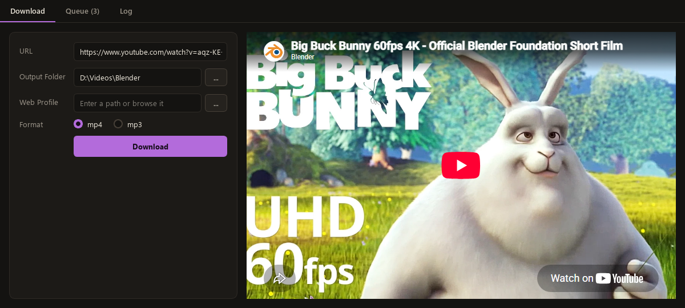
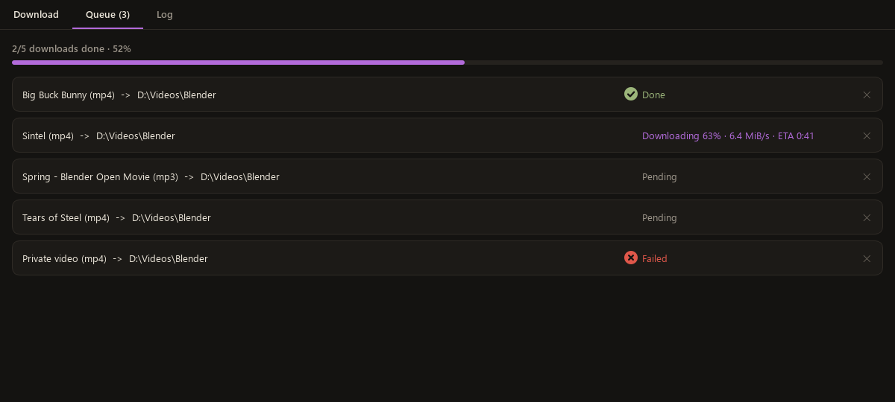
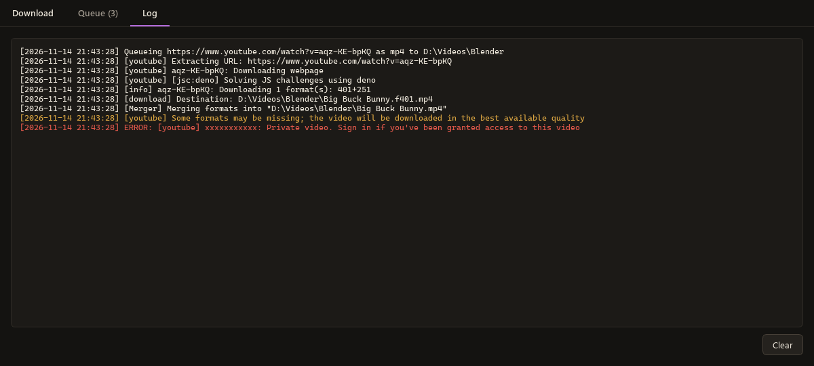

# Shuvi

Download YouTube videos and playlists as MP4 or MP3, from a simple Windows app.



## Features

- **Videos and whole playlists**: paste any YouTube link, Shuvi figures out the rest.
- **MP4 or MP3**: best quality video, or the audio only.
- **Preview before downloading**: watch the video, and see every video of a playlist.
- **Download queue**: queue as many downloads as you want, follow their speed and time left, cancel any of them.
- **Picks up where it left off**: run a playlist again and only the new videos are downloaded.

## Install

1. Download `Shuvi-windows.zip` from the [latest release](https://github.com/Pe4natsu/shuvi/releases/latest).
2. Unzip it anywhere, for example in `Documents\Shuvi`.
3. Run `Shuvi.exe`.

Everything Shuvi needs is in the zip: there is nothing else to install.

> Windows may warn that the app is from an unknown publisher, because it is not signed.
> Click **More info**, then **Run anyway**.

**Requirements:** Windows 10 or 11 (64-bit), and [Firefox](https://www.mozilla.org/firefox/) with YouTube opened at least once.

## First launch: link your Firefox profile

YouTube blocks downloads that do not come from a real browser session. Shuvi borrows the one of your
Firefox, so it needs to know where your Firefox profile is. Nothing is sent anywhere else.

1. In Firefox, open `about:profiles` in the address bar.
2. Copy the **Root Directory** of the profile in use, it looks like
   `C:\Users\you\AppData\Roaming\Mozilla\Firefox\Profiles\abcd1234.default-release`.
3. In Shuvi, paste it in **Web Profile** (or click **...** and select that folder).

To avoid doing it on every launch, create a file named `.env` next to `Shuvi.exe` containing:

```ini
WEB_PROFILE=C:\Users\you\AppData\Roaming\Mozilla\Firefox\Profiles\abcd1234.default-release
```

## Download something

1. Paste a YouTube link in **URL**: a video, a short, or a playlist.
   The video appears on the right; for a playlist, its videos are listed next to it.
2. Choose an **Output Folder**.
3. Pick **mp4** (video) or **mp3** (audio only).
4. Click **Download**.

Downloads go to the **Queue** tab and run one after the other, so you can queue several and keep browsing.



- The bar at the top shows the progress of the whole queue.
- Each line shows the speed and time left of the file being downloaded.
- Click **✕** to cancel a download, or to remove a finished one from the list.
- The number in the tab title is how many downloads are not finished yet.

### What you get

| You paste | You get in the output folder |
| --- | --- |
| A video | `Title.mp4` or `Title.mp3` |
| A playlist | `001 - Title.mp4`, `002 - Title.mp4`... in playlist order |
| A video of a playlist (`watch?v=...&list=...`) | The whole playlist, as above |

MP4 files are in the best quality available. MP3 files are encoded at 192 kbit/s.

For playlists, Shuvi keeps a small `downloaded_mp4.txt` (or `downloaded_mp3.txt`) in the folder:
it lists what is already downloaded, so running the same playlist again only fetches the new videos.

## When something goes wrong

The **Log** tab shows what Shuvi is doing. Warnings are in yellow, errors in red, and **Clear** empties it.



| What you see | What to do |
| --- | --- |
| A download shows **Failed** right away | Check that **Web Profile** points to your Firefox profile folder (see [First launch](#first-launch-link-your-firefox-profile)). |
| **Failed** or **Finished with errors** on some videos | Open the **Log** tab: private, deleted or age-restricted videos are listed in red. Opening YouTube in Firefox and signing in fixes the age-restricted ones. |
| The preview says *Video unavailable* | The owner does not allow playing it outside YouTube. The download still works. |
| **Cancelling...** takes a few seconds | Shuvi waits between files so that YouTube does not block you; the cancel happens at the end of that pause. |
| Downloads were fine and suddenly all fail | YouTube changes often. Download the [latest release](https://github.com/Pe4natsu/shuvi/releases/latest), which comes with an updated downloader. |

A cancelled download leaves a `.part` file in the output folder: delete it, or download the same video again
to resume it.

## Command line

When running from source (see below), two commands do the same without the window:

```powershell
uv run shuvi-video    --url "https://www.youtube.com/watch?v=..." --output-folder "D:\Videos" --format mp3
uv run shuvi-playlist --url "https://www.youtube.com/playlist?list=..." --output-folder "D:\Videos"
```

`--format` is `mp4` (default) or `mp3`. Both read the Firefox profile from `WEB_PROFILE` in a `.env` file.

## Run from source

You need [uv](https://docs.astral.sh/uv/) and [ffmpeg](https://ffmpeg.org/download.html)
(either on your `PATH`, or `ffmpeg.exe` and `ffprobe.exe` in a `bin` folder at the root of the project).

```powershell
git clone https://github.com/Pe4natsu/shuvi.git
cd shuvi
uv sync
uv run shuvi
```

To build `Shuvi.exe` yourself, put ffmpeg in `bin`, then run `uv run pyinstaller shuvi.spec --noconfirm`:
the app is created in `dist\Shuvi`. Pushing a `v*` tag builds it on GitHub and publishes a release.

The version shown in the window title comes from `shuvi/__init__.py`.

## Good to know

- Only download videos you have the right to keep, and respect YouTube's Terms of Service and the creators' copyright.
- Shuvi is built on [yt-dlp](https://github.com/yt-dlp/yt-dlp), [FFmpeg](https://ffmpeg.org/) (shipped under the GPL,
  see `FFMPEG-LICENSE.txt` in the zip), [Deno](https://deno.com/) and [Qt for Python](https://doc.qt.io/qtforpython-6/).
